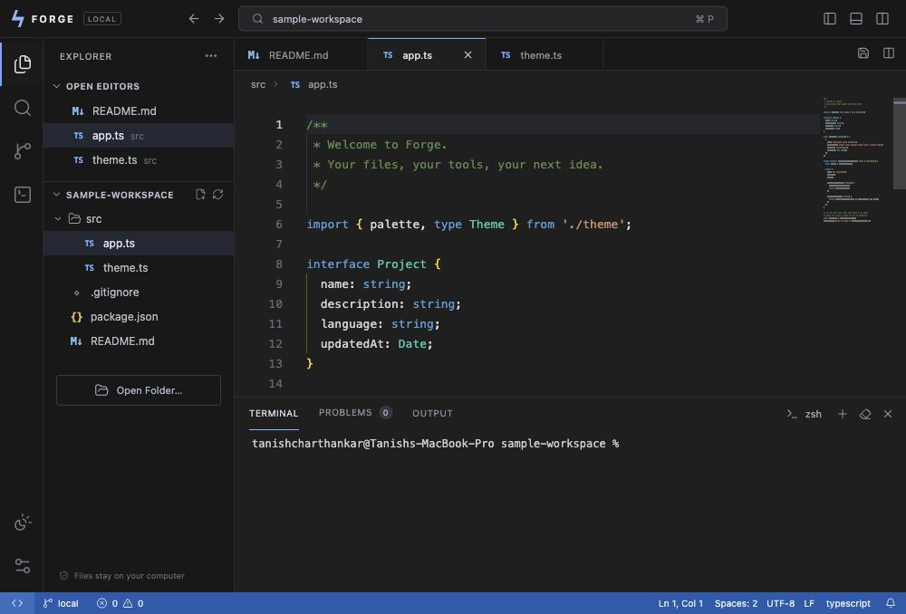

# Forge

A working local desktop code editor inspired by VS Code. Built after inspecting the installed VS Code 1.142.0 app with REA 6.7.0 and directly reading its shipped metadata and preload bridge.



## Open it

On macOS, install Node.js 24 and Python 3, then run:

```sh
git clone https://github.com/tanish120704/forge-editor.git
cd forge-editor
npm install
npm run build
npm start
```

Choose **Open Folder…** or press **⌘O** to work on your own project. After installing and building, you can also double-click **Launch Forge.command**. It opens an adjacent Forge.app when present, or starts the source version using Node on your PATH or in a standard Homebrew location. The terminal defaults to `/usr/bin/python3`; set `FORGE_PYTHON` if Python is installed elsewhere.

To create a local macOS app containing its own Electron runtime, run `python3 scripts/package-mac.py`. It creates **Forge.app** next to this repository and applies an ad hoc signature. It is a development build, not an Apple-notarized distribution.

## What works

- Native macOS window, menus, and folder picker.
- Real local files, expandable explorer, new files, tabs, and per-tab cursor/scroll state.
- Monaco syntax highlighting, completion, folding, multiple cursors, find/replace, and supported-language formatting.
- Basic JavaScript/TypeScript diagnostics and cross-file imports. Indexes up to 100 JS/TS source files and 2 MB for language assistance.
- Save / Save All with revision checking and atomic file replacement. Unsaved tabs require confirmation before closing or switching folders.
- Quick Open, a searchable command palette, and workspace text search.
- A real interactive shell with xterm.js and a Unix PTY; terminal input runs commands with your user permissions.
- Git branch and changed-file status. Git changes are read-only in the sidebar; use the terminal for Git commands.
- Split views of the current document, resizable panes, light/dark themes, font size, minimap, and word wrap.

## Shortcuts

| Shortcut | Action |
| --- | --- |
| ⌘O | Open folder |
| ⌘N | New file |
| ⌘S / ⌘⌥S | Save / Save All |
| ⌘P | Quick Open |
| ⌘⇧P | Command palette |
| ⌘⇧F | Workspace search |
| ⌘⇧E | Explorer |
| ⌘W | Close active tab |
| ⌘B | Toggle sidebar |
| Control + backtick | Toggle terminal |
| ⌘ + backslash | Split editor |
| ⌘, | Settings |

## Develop

Requires Node.js 22.12+ or 24+, npm, and Python 3 for the Unix terminal. The tested environment used Node 24.19.0, Electron 44.9.0, Monaco 0.57.0, and Vite 8.3.4. Exact dependencies and the pnpm lockfile are included.

```sh
npm install
npm run build
npm start
```

Browser preview:

```sh
npm run serve
# Open the complete local URL printed in the terminal, including its fragment.
```

Use `npm run dev` for the Vite development middleware. The production app binds only to loopback, uses a per-launch random API token, and checks the request host and origin. The frontend has no direct Node.js access. File APIs resolve paths within the chosen workspace, reject escaping symlinks, and detect stale writes. This is a trusted local development tool, not a multi-user hosting service.

Run `npm test` for the filesystem, search, HTTP authentication, and real PTY checks. Run `python3 scripts/package-mac.py` after building to create the adjacent Forge.app; the script expects that destination not to exist.

## Scope

This prototype implements core editing workflows. It does not include a VS Code extension host or Marketplace compatibility, debugger, remote SSH/dev containers, language-server management, AI assistant, live external-file watching, autosave, file rename/delete, or a full Git interface. Split view shows the same active file in two panes. It opens UTF-8 text files up to 4 MB; binary/other-encoding files are refused. Search inventories at most 3,000 files, descends at most 20 folders deep, returns at most 300 matches, and skips dependency/build directories. Search reports disk contents, so save an edit before searching for it. Preferences and tab state persist; unsaved buffers are not crash-recovered.

The source launcher stores preferences in `.local-data/` within the project. The packaged app stores its local preferences and sample workspace beside the app under `Forge-data/`. Keep that folder writable and together with the app. Your selected project files remain in their original folder.

The [investigation report](docs/investigation.md) describes the actual reverse-engineering scope and the REA cleanup limitation. [Verification results](docs/verification.txt) record the nine passing checks. This is an independently implemented editor shell using open-source components, not a recovery of all VS Code source or a full VS Code replacement.
