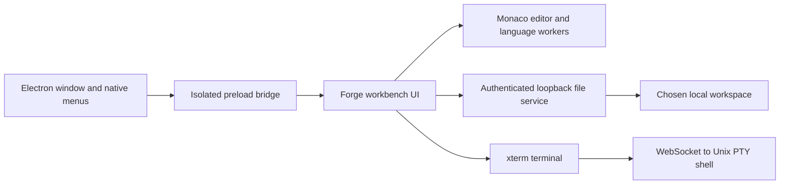

# VS Code investigation and Forge implementation

Inspected on 20 October 2026. The target was `/Applications/Visual Studio Code.app`, version **1.142.0 stable**, build commit `6d62b1d5dace93a33b3a6d3eca1317bd5e15bcb1`, build date `2026-10-15T03:02:17Z`.

## What was actually analyzed

REA 6.7.0 was installed locally from the official `rea-agents` npm package. Its JavaScript analyzer inventoried the extracted application directory and selected these three files for static parsing:

1. `out/main.js` — application entrypoint.
2. `out/bootstrap-fork.js` — child-process bootstrap.
3. `out/vs/base/parts/sandbox/electron-browser/preload.js` — renderer bridge.

The retained partial evidence reports **6,166 relevant files**, **3 parsed JavaScript files**, **39,063 visited AST nodes**, **52 findings**, and **0 parse failures**. It found **one context bridge with six exposed members** and **seven IPC operations**, including one literal channel and six dynamic channel operations.

The command ended with `cleanup_incomplete`: macOS process-table inspection was denied by the execution sandbox, so REA could not confirm worker cleanup. This is a partial result, not a clean successful full-app analysis. The initial compiler-cache issue was resolved using `REA_DARWIN_MODULE_CACHE_PATH`; the process-table restriction remained. No native binary decompiler, runtime instrumentation, or full workbench reconstruction was performed. Findings absent from the three selected files do not imply absence elsewhere in VS Code.

`rea-summary.json` contains a compact result and limitations. The complete returned error envelope and partial evidence are retained locally as `rea-vscode-evidence.json.gz`; the large raw archive is not included in this source repository. `installed-vscode-inventory.json` records hashes, sizes, package metadata, and selected dependencies read directly from the app.

## Architecture supported by the installed artifacts

| Layer | Installed evidence | How Forge applies the idea |
| --- | --- | --- |
| Main process | `package.json` declares `./out/main.js`; `out/mainImpl.js` is a separate 1.35 MB bundle | Electron main process creates a window, menus, and native folder picker |
| Renderer bridge | The 2,287-byte preload exposes `vscode` through `contextBridge.exposeInMainWorld` | A small isolated preload exposes folder selection and menu commands |
| Workbench | `out/vs/workbench/workbench.desktop.main.js`, about 20.7 MB | Independent interface for explorer, tabs, search, settings, and terminal |
| Extension host | `out/vs/workbench/api/node/extensionHostProcess.js`, about 2.3 MB; 96 shipped extension manifests | Not implemented in this prototype |
| Terminal | `out/vs/platform/terminal/node/ptyHostMain.js`; package dependencies include `node-pty` and xterm | xterm.js talks over a local WebSocket to a Python Unix PTY |
| Search and filesystem | Dependencies include `@vscode/ripgrep-universal` and `@parcel/watcher` | Bounded workspace text search and explicit refresh; no live watcher |
| Syntax and language services | Dependencies include `vscode-textmate` and `vscode-oniguruma` | Monaco supplies editor and bundled language services |

The bridge was also read directly. It accepts IPC channel strings beginning with `vscode:`, invokes the literal `vscode:fetchShellEnv` channel, and exposes `ipcRenderer`, `ipcMessagePort`, `webFrame`, `webUtils`, `process`, and `context`. These are observations of the shipped code, not claims that every exposed operation was executed or that its security properties were fully audited.



The diagram describes **Forge's implementation**. The table above distinguishes it from the observed VS Code layout.

## Reproduce the REA pass

With a supported Node.js runtime and the official REA CLI installed:

```sh
mkdir -p ./work/clang-cache
REA_DARWIN_MODULE_CACHE_PATH="$PWD/work/clang-cache" \
  npx rea-agents@6.7.0 analyze-javascript-application \
  '/Applications/Visual Studio Code.app/Contents/Resources/app' \
  --source-path out/main.js \
  --source-path out/vs/base/parts/sandbox/electron-browser/preload.js \
  --source-path out/bootstrap-fork.js \
  --analysis-timeout-ms 45000 --format json > rea-vscode-evidence.json
```

The package's requirements are Node 22.19+, supported Node 24.11+, or Node 26+. Static analysis reads the artifact as data. The command may require process-inspection permissions that this sandbox did not provide.

## Verification of the new editor

The production Vite build passed. Nine automated checks passed: actual disk save and permission preservation, outside-edit conflicts, concurrent-save conflicts, path and symlink confinement, exclusive new-file creation and binary rejection, search positions and dependency exclusion, HTTP authentication/origin checks, nested-repository Git paths, and real shell execution in the selected workspace.

UI checks in the local browser preview verified new-file creation, text input and save to disk, an unsaved-changes dialog, Quick Open selecting `theme.ts`, two workspace search results for `createWorkspace`, and zero diagnostics in the sample after cross-file language indexing. No browser warning/error logs were reported in that checked session. The final packaged native app launched with the expected window title, the sample file open, and zero diagnostics. The package matches the final source and passed macOS code-signature verification. Native screenshot capture was unavailable through the computer-control tool; the saved preview is the same frontend running in the local browser.

## Upstream references

- [REA repository and CLI overview](https://github.com/morluto/rea)
- [REA JavaScript analysis workflows and limitations](https://github.com/morluto/rea/blob/main/docs/javascript-application-workflows.md)
- [Monaco Editor: its relationship to VS Code](https://github.com/microsoft/monaco-editor)

VS Code's installed product resources were inspected in place. Forge uses independently written application code and open-source components; it does not redistribute the installed VS Code product bundles.
